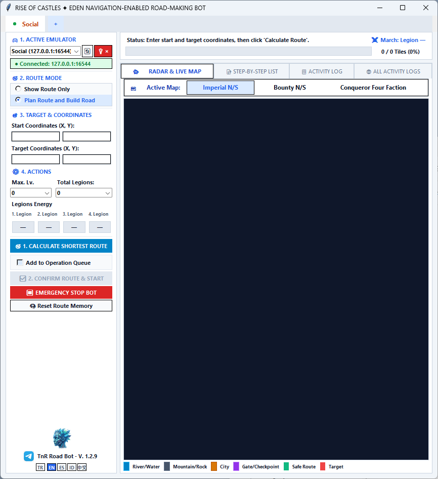
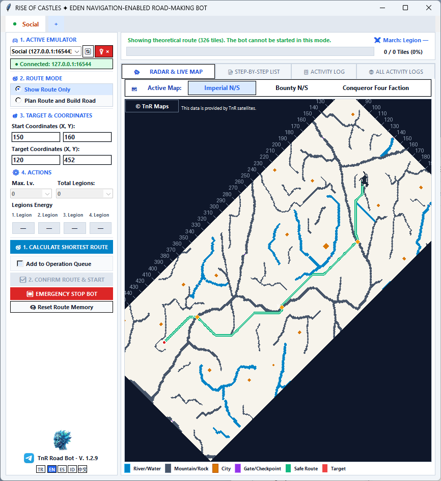
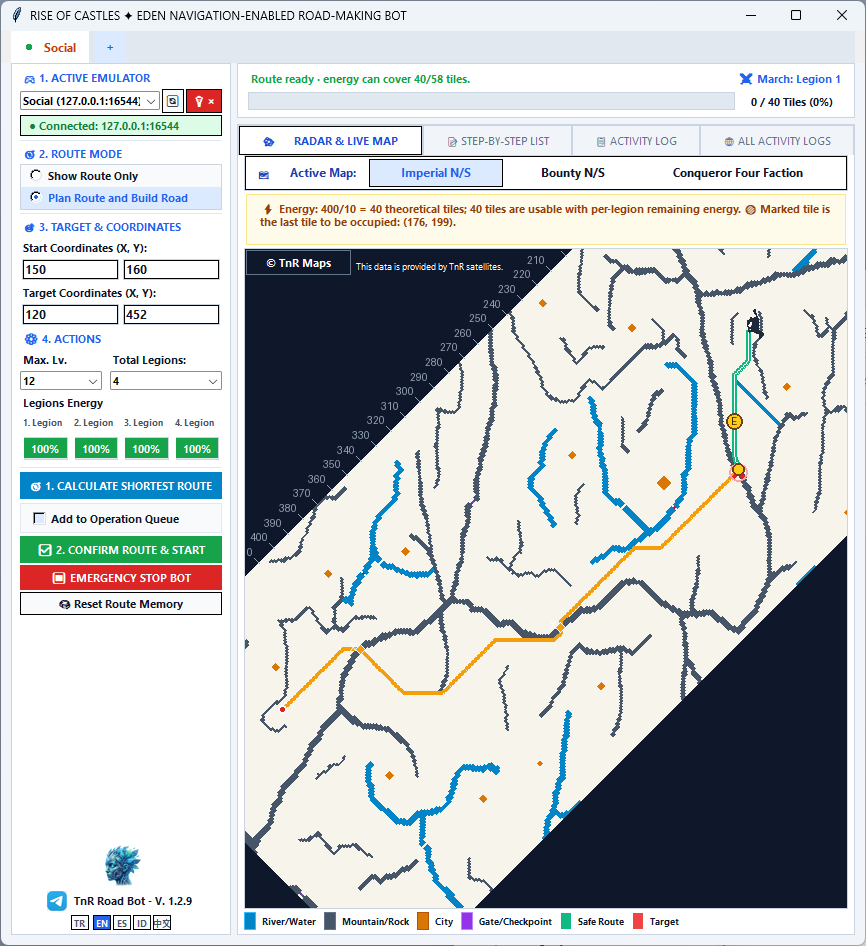
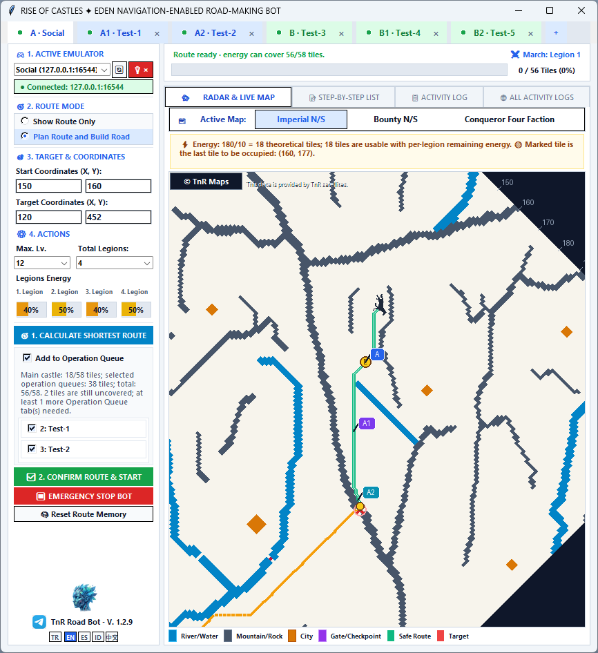

# TnR Road Bot

**A Windows application that plans safe road routes and automates road building in Rise of Castles.** RoadBot controls the game through MuMu Player, calculates a route between the start and target coordinates you choose, and executes it after your confirmation.

[Download the latest EXE](https://github.com/UnsetEntity/TnR_Road_Bot/releases) 

[YOUTUBE Videos](https://www.youtube.com/@UnsetEntity) 

## Required MuMu Display Settings

Before using RoadBot, set the display configuration of the emulator created in MuMu Player to these values:

* **Resolution:** `1280 × 2560`
* **DPI:** `480`
* **Orientation:** Portrait

If these settings are incorrect, screen tap coordinates and OCR readings may not work as expected. Apply the settings to the emulator profile, then restart the emulator.

## Features

* Calculate the shortest safe route between two coordinates
* Analyze obstacles such as mountains, rivers, cities, gates, bridges, and mountain passes
* Preview a route or execute it in-game after confirmation
* Check terrain level and legion energy, then dispatch an available legion
* Stop safely before non-occupiable crossings such as bridges and mountain passes
* Radar map, step-by-step route list, and obstacle report
* **Multiple routes in one window:** Create separate operation queues for different routes and run them at the same time. Each bot follows its own route independently. In addition to queued bots, you can start an independent bot tab for another route. The number of operations that can run simultaneously depends on your computer's hardware.
* Activity logs, emulator connection management, and emergency stop
* Interface available in Turkish, English, Spanish, Indonesian, and Simplified Chinese
* Supported maps: Eden Imperial (North \& South), Eden Bounty (North \& South), Eden Conqueror (Four Faction)

## Screenshots

<table>
	<tr>
		<td align="center"> Main screen</td>
		<td align="center"> Route preview</td></tr>
	<tr>
		<td align="center"> Calculated route and legion energy</td>
		<td align="center"> Multiple bots and operation queue</td>
	</tr>
</table>

## Requirements

* Windows 10 or 11, 64-bit
* MuMu Player Global 12.0 with Rise of Castles installed
* Emulator created in MuMu with **1280 × 2560 resolution, 480 DPI, and portrait orientation**
* ADB and MuMu Manager included with MuMu Player
* Internet access to download map data and check for application updates

You do not need to install Python or Python packages. If the installer cannot find Tesseract OCR 5.5.3 and the required English/Turkish OCR data, it will try to download and install them. Windows may request administrator permission during installation.

## Installation and Use

1. Download the installer EXE from the [latest releases page](https://github.com/UnsetEntity/TnR_Road_Bot/releases).
2. Run the installer and follow the prompts.
3. In MuMu Player, set the emulator display to `1280 × 2560`, `480 DPI`, and portrait orientation. Restart the emulator, then sign in to Rise of Castles.
4. In the game, disable the legion march animation and select **Lite Mode** in the game settings.
5. Launch RoadBot from the desktop shortcut and select the connected emulator.
6. Choose a map and enter the start/target coordinates, terrain level limit, and legion details.
7. First review the route with **Show Route Only**. To build a road, select **Plan Route and Build Road** and inspect the calculated route.
8. Use **Emergency Stop** if needed while the bot is running.
9. [YOUTUBE Videos](https://www.youtube.com/@UnsetEntity) 

## Map Data and Connectivity

Map data is stored in local databases included with the application. Loading maps and planning routes do not require an internet connection. Internet access is only needed to check for and download application updates.

RoadBot uses ADB to tap coordinates in the emulator and OCR to read information from the game screen. Changing the game window or emulator layout while the bot is running may cause tap coordinates to become misaligned.

## Safe Use

Check the coordinates and route preview before starting. The bot performs actions in-game; make sure your use complies with the Rise of Castles terms of service.

